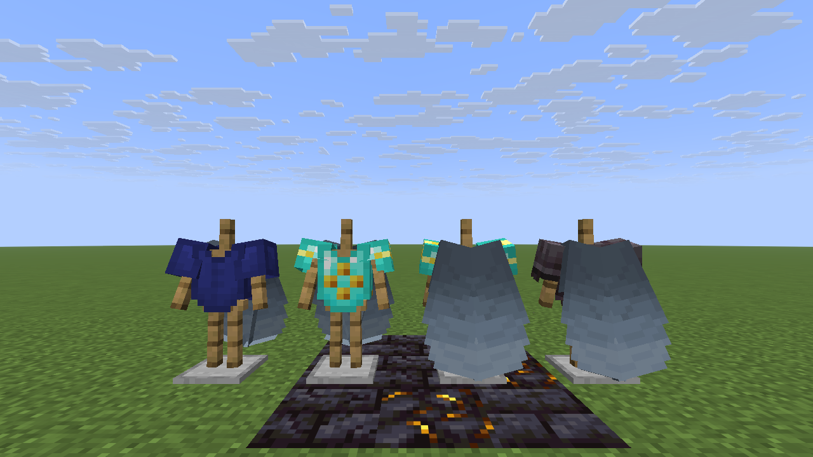

# BCF QOL Improvements Resources

A resource pack for Minecraft 26.3 that draws the **armored elytra** of the BCF QOL Improvements data pack: a player
wearing one shows the chestplate and the elytra wings at the same time, with the chestplate's trim and dye.

It has no textures of its own. For each chestplate material (leather, chainmail, copper, gold, iron, diamond,
netherite) an equipment asset `bcfqolimprovements:armored_elytra_<material>` combines the vanilla armor layer with
the vanilla elytra wings. Armor trims are drawn on every layer of an equipment asset, wings included, and vanilla has
no trim textures for wings, so the pack adds empty ones: the trim shows on the chestplate only.

## Download

Get `bcfqolimprovements-resources-<version>.zip` from the [releases](../../releases). On a server, put its download
URL and SHA-1 into `server.properties` (`resource-pack`, `resource-pack-sha1`) and every player gets it when joining.
Players can also add it themselves under Options → Resource Packs.

Without the data pack the resource pack does nothing; without the resource pack a player wearing an armored elytra
shows neither the chestplate nor the wings.

## License

MIT, see [LICENSE](LICENSE). By BaconCakeFactory.
